<div align="center">

  

  <br/><br/>

  <p>
    
    <a href="https://im-nafis.vercel.app"></a>
    <a href="https://linkedin.com/in/muhammad-nafis-alfa-rizky"></a>
    <a href="mailto:nafisalfa97@gmail.com"></a>
  </p>

</div>

---

### How I Work

I study biology and build web applications on the side. Starting without a formal computer science background, I use AI as a pair-programming tool to speed up learning and prototyping, then manually review, edit, and test the code so the final product stays clean, fast, and genuinely useful.

```mermaid
flowchart LR
    A([Real Problem]) --> B[Break Down Logic]
    B --> C{Draft with AI}
    C -->|Raw Code| D[Manual Edit & Testing]
    D -->|Clean UI & Code| E([Working Web App])
    E -.->|User Feedback| B

    style A fill:#0F172A,stroke:#00C2FF,stroke-width:2px,color:#FFFFFF
    style B fill:#0F172A,stroke:#39FF14,stroke-width:1.5px,color:#FFFFFF
    style C fill:#0F172A,stroke:#FFEA00,stroke-width:2px,color:#FFFFFF
    style D fill:#0F172A,stroke:#FF003C,stroke-width:2px,color:#FFFFFF
    style E fill:#0F172A,stroke:#B026FF,stroke-width:2px,color:#FFFFFF
